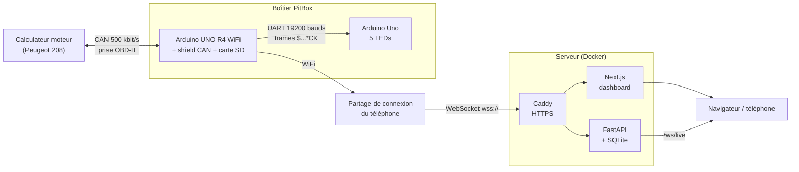

# PitBox

Boîtier de télémétrie OBD-II : il lit les données du calculateur moteur sur le bus CAN, les enregistre sur carte SD, les affiche sur des LEDs dans l'habitacle et les envoie en direct à un dashboard web.

> **Statut : MVP.** Version construite avec des cartes du commerce (Arduino UNO R4 WiFi, shield CAN, Arduino Uno). Une carte sur mesure à base d'ESP32-S3 est en cours de conception dans [`pcb/`](pcb/).

Voiture de test : Peugeot 208.

---

## Sommaire

- [Architecture](#architecture)
- [Organisation du dépôt](#organisation-du-dépôt)
- [Matériel](#matériel)
- [Branchements](#branchements)
- [Protocole des trames](#protocole-des-trames)
- [Sécurité du bus CAN](#sécurité-du-bus-can)
- [Firmware](#firmware)
- [Dashboard](#dashboard)
- [Carte électronique](#carte-électronique)
- [Workflow Git](#workflow-git)
- [Feuille de route](#feuille-de-route)

---

## Architecture



La R4 interroge le calculateur toutes les 50 ms, produit une trame toutes les 100 ms et l'envoie :

1. à l'Uno, qui pilote les LEDs ;
2. au serveur, par paquets toutes les 250 ms ;
3. à la carte SD, où chaque session est écrite dans `SESSxxx.CSV` et les événements dans `EVENTS.CSV`.

## Organisation du dépôt

```
PitBox/
├── firmware/
│   ├── r4_can/          UNO R4 WiFi + shield CAN : lecture OBD-II, SD, WiFi (version principale)
│   ├── r4_elm327/       UNO R4 WiFi + boîtier ELM327 WiFi (variante sans shield CAN)
│   └── nano_leds/       Arduino Uno : affichage sur 5 LEDs
├── dashboard/
│   ├── server/          API FastAPI, base SQLite, simulateur de R4
│   ├── web/             Dashboard Next.js (Live, Sessions, Journal, Dash téléphone)
│   ├── Caddyfile
│   └── docker-compose.yml
└── pcb/                 Schéma KiCad de la future carte ESP32-S3
```

## Matériel

| Élément | Référence | Rôle |
|---|---|---|
| Carte principale | Arduino UNO R4 WiFi | Requêtes OBD-II, journal SD, envoi WiFi |
| Interface CAN | Seeed CAN-BUS Shield V2 (MCP2515, quartz 16 MHz) | Connexion au bus CAN de la voiture, lecteur microSD |
| Affichage | Arduino Uno R3 | Pilote les 5 LEDs |
| LEDs | blanche, rouge, verte, jaune, bleue + résistances 220 à 330 Ω | Informations pour le conducteur |
| Câble | OBD-II mâle vers fils nus | Raccordement à la prise diagnostic |
| Variante | Boîtier ELM327 WiFi | Remplace le shield CAN dans `r4_elm327` |

## Branchements

### 1. Prise OBD-II vers shield CAN

La prise OBD-II se trouve sous le volant. Vue de face, côté broches :

```
        ┌───────────────────────────────────────┐
         \   1   2   3   4   5   6   7   8     /
          \  9  10  11  12  13  14  15  16    /
           └─────────────────────────────────┘

   Broche OBD          Fil                    Shield CAN
   ──────────          ───                    ──────────
       6   ─────────── CAN High ───────────►  CAN_H
      14   ─────────── CAN Low  ───────────►  CAN_L
       5   ─────────── Masse signal ───────►  GND
       4   ─────────── Masse châssis         (non utilisée)
      16   ─────────── +12 V batterie        (non utilisée : le MVP est alimenté en USB)
```

Le bus de la voiture est déjà terminé par ses propres résistances de 120 Ω : la résistance de terminaison du shield doit rester désactivée.

### 2. Shield CAN sur la R4

Le shield s'empile directement sur la R4. Broches utilisées :

```
   UNO R4 WiFi                  Seeed CAN-BUS Shield V2
   ───────────                  ───────────────────────
      ICSP SCK   ◄──────────►   SCK   ┐
      ICSP MISO  ◄──────────►   MISO  ├─ bus SPI partagé (connecteur ICSP à 6 broches)
      ICSP MOSI  ◄──────────►   MOSI  ┘
       D9        ───────────►   CS du MCP2515 (contrôleur CAN)
       D4        ───────────►   CS du lecteur microSD
       D2        ◄───────────   INT du MCP2515
```

Si le shield ne répond pas (état `2` sur la liaison série), essayer `CAN_CS = 10` dans `r4_can.ino`.

### 3. R4 vers Uno (liaison série)

```
   UNO R4 WiFi                         Arduino Uno
   ───────────                         ───────────
     D1 (TX, Serial1) ──────────────►  D8 (RX, SoftwareSerial)
     GND ────────────────────────────  GND
```

- 19200 bauds, sens unique : la R4 parle, l'Uno écoute.
- **Ne pas relier les 5 V** des deux cartes si elles sont alimentées chacune par USB.

### 4. LEDs sur l'Uno

```
   Arduino Uno
   ───────────
     D3 ──[ R ]──►|── GND    LED blanche   (PWM)
     D4 ──[ R ]──►|── GND    LED rouge
     D5 ──[ R ]──►|── GND    LED verte
     D6 ──[ R ]──►|── GND    LED jaune
     D7 ──[ R ]──►|── GND    LED bleue

     R = 220 à 330 Ω, patte longue de la LED (anode) côté résistance
```

| LED | Signification |
|---|---|
| Blanche fixe | Liaison OK, mais aucune donnée de la voiture |
| Blanche clignotante | Plus de trame de la R4 depuis 500 ms |
| Rouge clignotante lente | Température moteur ≥ 105 °C |
| Rouge fixe | Température moteur ≥ 115 °C |
| Rouge clignotante rapide | Erreur du shield CAN |
| Jaune | Moteur froid (< 70 °C) |
| Verte | Passer la vitesse (≥ 6000 tr/min) |
| Bleue | Rétrograder (entre 1100 et 2000 tr/min) |

### 5. Variante ELM327

```
   Peugeot 208                ELM327 WiFi                     UNO R4 WiFi
   ───────────                ───────────                     ───────────
   prise OBD-II  ◄──────────  branché dans la prise   ))) WiFi )))  réseau "WiFi_OBDII"
                                                                    TCP 192.168.0.10:35000
                                                                       │
                                                                       └── D1 ──► Uno D8 (comme ci-dessus)
```

La R4 utilise son WiFi pour parler à l'ELM327 : cette variante n'envoie rien au serveur. Elle compile mais n'a pas encore été testée sur la voiture.

## Protocole des trames

Toutes les lignes sont en texte, terminées par `\n`, et finissent par une somme de contrôle `*CK` : le XOR de tous les caractères entre le premier caractère et `*`, écrit en hexadécimal sur deux chiffres.

| Préfixe | Format | Fréquence |
|---|---|---|
| `$` | `$seq,t_ms,regime,temp,vitesse,charge,papillon,etat,voyant,defauts,tension*CK` | toutes les 100 ms |
| `#D` | `#D,P0301,P0420*CK` | toutes les 5 s et dès que les codes changent |
| `#E` | `#E,t_ms,CODE,detail*CK` | à chaque événement |

Champs de la trame `$` :

| Champ | Unité | Source OBD-II |
|---|---|---|
| `seq` | numéro de trame, repart de 0 au démarrage | |
| `t_ms` | millisecondes depuis le démarrage de la R4 | |
| `regime` | tr/min | mode 01, PID `0C` |
| `temp` | °C, liquide de refroidissement | PID `05` |
| `vitesse` | km/h | PID `0D` |
| `charge` | % | PID `04` |
| `papillon` | % | PID `11` |
| `etat` | `0` pas de données, `1` OK, `2` erreur CAN | |
| `voyant` | voyant moteur allumé (`0`/`1`) | PID `01` |
| `defauts` | nombre de codes défaut | PID `01` |
| `tension` | dixièmes de volt | PID `42` |

- `-100` signifie « valeur jamais reçue ».
- L'Uno ne lit que les 8 premiers champs.
- Les codes défaut (mode 03) arrivent sur plusieurs trames CAN et sont réassemblés en ISO-TP.

## Sécurité du bus CAN

Le boîtier ne doit jamais modifier le comportement de la voiture. Toute trame envoyée sur le bus passe par `envoyerSurBus()`, qui n'autorise que :

| Trame | Identifiant | Contenu |
|---|---|---|
| Demande de donnée | `0x7DF` | mode `01` |
| Demande des codes défaut | `0x7DF` | mode `03` |
| Contrôle de flux ISO-TP | `0x7E0` à `0x7E7` | premier octet `0x30` |

Tout le reste (effacement des codes, écriture, commande d'actionneurs) est bloqué et enregistré comme événement `ENVOI_REFUSE`.

## Firmware

Les sketches se compilent avec l'IDE Arduino.

| Sketch | Carte | Bibliothèques |
|---|---|---|
| `firmware/r4_can` | Arduino UNO R4 WiFi (`arduino:renesas_uno:unor4wifi`) | `mcp_can` (Seeed), `SD`, `SPI`, `WiFiS3` |
| `firmware/r4_elm327` | Arduino UNO R4 WiFi | `WiFiS3` |
| `firmware/nano_leds` | Arduino Uno (`arduino:avr:uno`) | `SoftwareSerial` |

### Configuration de `r4_can`

1. Copier `arduino_secrets.example.h` en `arduino_secrets.h` et renseigner le WiFi, le jeton et l'adresse du serveur.
2. Choisir le mode en haut de `r4_can.ino` :

| Constante | `0` | `1` |
|---|---|---|
| `SIMULATION` | lit la vraie voiture | génère des données de test, sans voiture |
| `TELEMETRIE` | pas d'envoi au serveur | envoi au serveur par WiFi |

Sous Linux, le port USB peut demander les droits : `sudo chmod a+rw /dev/ttyACM0`.

## Dashboard

Serveur FastAPI et dashboard Next.js, déployés avec Docker Compose derrière Caddy. Le détail des pages, des sessions, du journal et des sauvegardes est dans [`dashboard/README.md`](dashboard/README.md).

```bash
cd dashboard
cp .env.example .env          # renseigner PITBOX_TOKEN (openssl rand -hex 24)
docker compose up -d --build
```

Tester sans matériel, avec le simulateur de R4 :

```bash
python server/simulateur_r4.py ws://localhost/ws/ingest LE_JETON --duree 60
```

## Carte électronique

[`pcb/`](pcb/) contient le schéma KiCad 10 d'une carte unique qui remplacera la R4, le shield CAN et l'Uno :

| Bloc | Composant |
|---|---|
| Microcontrôleur, WiFi, contrôleur CAN | ESP32-S3-WROOM-1 |
| Transceiver CAN | SN65HVD230 |
| Alimentation 12 V → 3,3 V | AP63203, fusible réarmable, diode anti-inversion, TVS |
| Stockage | microSD (SPI) |
| Programmation | USB-C natif, protection USBLC6 |

Ce schéma n'est pas encore validé. Corrections prévues :

- [ ] Remplacer le SN65HVD230 par un TCAN334 (protection contre un bus bloqué) et ajouter un pull-up sur `CAN_TX`
- [ ] Revoir la protection en entrée (TVS ou régulateur tolérant 60 V)
- [ ] Pont de mesure batterie 100 k / 10 k
- [ ] Résistances adaptées aux LEDs bleue et blanche
- [ ] Fusible réarmable tenant 30 V

## Workflow Git

| Branche | Rôle |
|---|---|
| `main` | Versions stables, taguées (`v0.1.0-mvp`) |
| `develop` | Intégration des fonctionnalités terminées |
| `feature/*` | Une fonctionnalité par branche, fusionnée dans `develop` |
| `docs/*` | Documentation |

Les messages de commit suivent [Conventional Commits](https://www.conventionalcommits.org/) : `feat:`, `fix:`, `docs:`, `chore:`.

## Feuille de route

- [x] Lecture OBD-II sur bus CAN, journal SD, LEDs
- [x] Envoi en direct et dashboard web
- [ ] Essai complet sur la Peugeot 208
- [ ] Carte ESP32-S3 sur mesure
- [ ] Version sport automobile : GPS 10 à 25 Hz, centrale inertielle, shift light RGB
